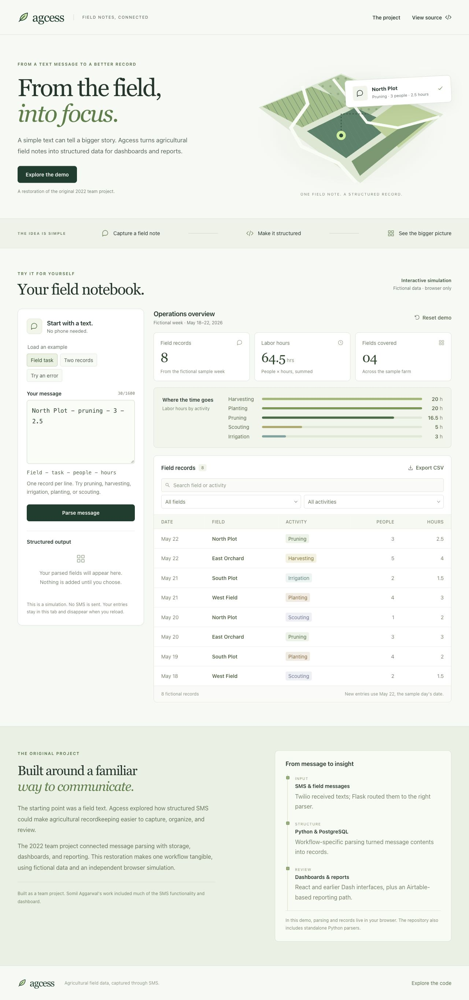

# Agcess

**Agricultural field data, captured through SMS.**

Agcess turns structured text messages into records that can be explored through dashboards and reports. Originally developed as a team project in 2022, it connects a familiar field interface—text messaging—with structured data tools.

This repository restores the core idea as an interactive browser demo and a standalone Python parser package. All examples are fictional. No messaging accounts, database credentials, or original client data are required.



## Try it locally

Use Node.js 24 (see `.nvmrc`):

```sh
npm ci
npm run dev
```

Open the URL printed by Vite. Load a sample message, parse it, and add the result to the dashboard. Filter records, compare labor hours by activity, export a CSV, or reset the notebook. Entries stay in memory and disappear when you reload.

```text
North Plot - pruning - 3 - 2.5
```

```json
{"field": "North Plot", "task": "pruning", "people": 3, "hours": 2.5}
```

## What is included

- **Interactive demo:** React/Vite, fictional sample data, bounded input validation, record preview, dashboard summaries, filters, CSV export, and reset.
- **Reusable Python parsers:** field work, five-token product metadata, and configured research-sampling records, without external service dependencies.
- **Shared contract fixtures:** the Python field-work parser and browser implementation run against the same inputs and expected results.
- **Automated checks:** Python tests, JavaScript tests, desktop/mobile browser flows, production build, and secret scanning.
- **GitHub Pages workflow:** publishes static assets after the reviewed implementation reaches `main`.

## Validate

Python 3.11 or newer is required for the parser checks.

```sh
npm test
PYTHONPATH=packages/parser python3 -m unittest discover -s packages/parser/tests -v
npm run build
```

For browser tests:

```sh
npx playwright install chromium
npm run test:browser
```

The browser suite checks the production build at the `/agcess/` project path, including mobile layout, errors, CSV exports, and resets.

## Original project and restoration

The original architecture used Python/Flask, Twilio, PostgreSQL, React, and earlier Dash/Airtable reporting paths. This restoration preserves selected parsing workflows and demonstrates the core product with a browser simulation. It does not revive the old hosted services.

The field-work parser intentionally replaces implicit batch expansion with explicit newline records and validation. The browser parser is a JavaScript equivalent, not a remote call to Python. Details and limits are documented below.

- [Architecture and restoration decisions](docs/architecture.md)
- [Parser contracts and legacy differences](docs/parser-contract.md)
- [Development, hosting, and PR review order](docs/deployment.md)
- [Product-focused portfolio copy](docs/portfolio.md)
- [Contributor credits](AUTHORS.md)
- [Restoration and licensing notice](NOTICE.md)

## Repository layout

```text
apps/demo/          React interface, browser parser, unit and browser tests
packages/parser/    Standalone Python package and tests
examples/           Shared fictional input/output fixtures
docs/               Architecture, contracts, portfolio copy, and deployment
.github/workflows/  Validation, secret scanning, and GitHub Pages
```

The original repositories did not include a license. No new open-source license has been assigned to shared work; see [NOTICE.md](NOTICE.md). This portfolio restoration retains team attribution and excludes private client information and original Git history.
