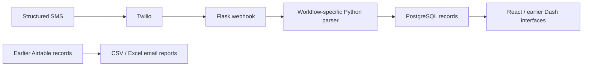
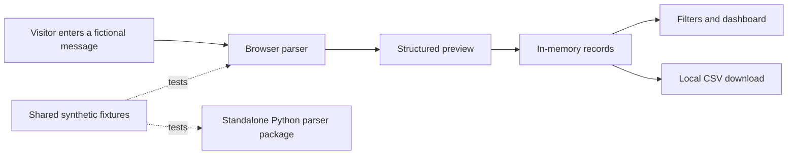

# Architecture and restoration decisions

## Original system

Agcess was a team project developed in 2022. The supplied source contains these paths:

The original project included field-work, product metadata, and research-sampling parsers. Dashboard and reporting paths evolved over time; the diagram describes the code found in the source, not a claim that all paths remain deployed or were production-ready together.

## Portfolio version

The browser does not call the Python package. A small JavaScript implementation reproduces the field-work contract and is tested against the same fixtures. Python retains all three selected workflows. The demo makes the original concept explorable without real messaging accounts or databases.

### Data boundaries

- All initial records and sample messages are fictional.
- New records live only in React memory. There is no local storage, analytics, remote API, database, or SMS/email delivery.
- Reloading restores the original examples. The reset action asks for confirmation before clearing session edits.
- CSV export includes only the filtered records. Values are quoted and formula-like cells are escaped defensively.
- Inputs are bounded to 1,600 characters, 20 records per message, and 200 total demo records. Batch validation is atomic.
- Rendered values use React text nodes. The demo does not inject user-provided HTML.
- Sample timestamps use a clearly labeled fictional week. New records are assigned May 22, 2026, within that sample week.

### What changed

The restored field-work parser keeps the four-part SMS format and supports explicit newline batches. It replaces implicit message reconstruction and combinatorial expansion, adds numeric validation, and retains multi-word field names. The [parser contract](parser-contract.md) documents the differences.

Research sample parsing now accepts an explicit location mapping. It does not decode private experiment configurations. Product metadata retains the original five-field mapping, but is not exposed as operational chemical guidance in the demo.

The original app initialization, authentication, account creation, database access, Twilio delivery, and email scripts are not imported. Restoring those integrations would require a separate implementation and operational review.

### Technology

The demo uses React and Vite, with no backend runtime. The Python package has no third-party parsing dependencies. A lockfile fixes JavaScript dependencies, and CI checks Python behavior, the shared browser contract, actual browser flows, the production build, and Git history for common secret patterns.

GitHub Pages serves the built static assets after the deployment workflow is merged into `main`. The build uses Pages' configured base path, and the app uses in-page anchors rather than routes requiring server rewrites.
